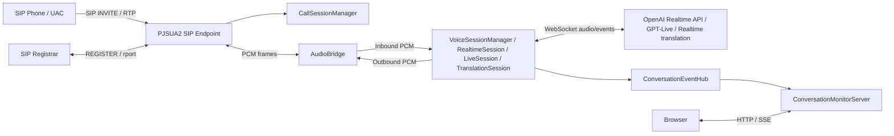

# Telephony OpenAI Gateway システム設計書

## 目的

本書は、`telephony-openai-gw`の現行実装を後から追跡・変更できるように整理した設計ドキュメントである。SIP/RTP、OpenAI Realtime API / GPT-Live / Realtime translation、会話モニターUI、マルチセッション制御、デプロイ構成を対象とする。

仕様変更時は、実装・設定例・運用手順に加えて、本書とdraw.io図も同じ変更単位で更新する。

## 関連図

draw.ioで編集できる図は以下に格納する。

- [telephony-openai-gw-design.drawio](diagrams/telephony-openai-gw-design.drawio)

このdraw.ioファイルは以下のページを持つ。

- `System Architecture`: システム全体構成
- `Call Flow Sequence`: 1通話の主要シーケンス
- `Class Overview`: 主要クラスと責務の関係
- `Audio Queue Detail`: inbound queue / outbound queueと音声処理の詳細
- `OpenAI Realtime Sequence`: OpenAI Realtime APIとのWebSocketイベントシーケンス
- `OpenAI Live Sequence`: GPT-Liveの開始、音声、transcript、終了シーケンス
- `OpenAI Translation Sequence`: 専用translationの設定、継続入力、字幕、終了シーケンス

## スコープ

本Gatewayは、SIP/RTP電話音声とOpenAI Realtime API / GPT-Live / Realtime translationを接続する軽量なJavaアプリケーションである。PBX機能は持たず、設定された複数の固定セッションスロットごとにSIP UASとしてINVITEを受け、通話ごとに設定されたbackendのOpenAI voice sessionを作成する。

### 対象

- SIP Registration
- UDP/IPv4によるSIP/RTP待ち受け
- PJSUA2 Java bindingによるSIP/RTP制御
- PCMU/G.722のSIP SDP offer/answerとPCM音声ブリッジ
- OpenAI Realtime API / GPT-Live / Realtime translationへの音声転送と音声応答受信
- 通話セッションごとの音声キュー分離
- 会話transcriptログとブラウザモニターUI
- RHEL 8.10およびmacOSでの稼働

### 対象外

- PBX機能、ルーティング、転送、保留
- STUN/ICE/TURN
- 認証付きWeb管理画面
- 長期保存DB
- 複数コールを1スロットで同時処理する機能

## 全体アーキテクチャ



### 主要コンポーネント

| コンポーネント | 主な責務 |
| --- | --- |
| `GatewayApp` | 設定読み込み後のコンポーネント生成、起動、停止順序制御 |
| `GatewayConfig` / `GatewayConfigLoader` | 設定ファイルの読み込み、デフォルト値、検証 |
| `PjsipEndpoint` | SIP backendの切り替え。現行は`pjsua2`または`placeholder` |
| `Pjsua2SipEndpoint` | PJSUA2 Endpoint、Transport、Account、Registration、Codec優先度、RTP port範囲制御 |
| `Pjsua2Account` | Registration状態監視、rport/received解析、着信INVITE処理 |
| `Pjsua2Call` | Call state/media state監視、AudioMediaとAudioBridgePortの接続 |
| `Pjsua2AudioBridgePort` | PJSUA2 conference bridgeと`AudioBridge`間のPCM入出力 |
| `CallSessionManager` | 通話セッション生成・終了・最近のセッション履歴保持 |
| `AudioBridge` | セッション別inbound/outbound audio queueとsample rate保持 |
| `VoiceSessionManager` | スロット別backendの選択、voice sessionの生成、音声転送worker・再試行管理 |
| `VoiceSession` | Realtime / Live / translation共通のsession lifecycle interface |
| `RealtimeSession` | OpenAI Realtime WebSocket、音声送受信、transcript、barge-in制御 |
| `TranslationSession` | 専用翻訳WebSocket、入力clock・無音補完、字幕、終了確認 |
| `TranslationTranscriptAssembler` | 原文・翻訳の独立snapshotとevent ID重複対策 |
| `LiveSession` | GPT-Live primary WebSocket、音声対話、挨拶、transcript、usage、終了確認 |
| `StreamingAudioDecoder` / `LiveTranscriptAssembler` | PCM delta境界の保持、話者別の表示segment集約 |
| `ConversationEventHub` | 会話transcript eventの保持とSSE subscriber通知 |
| `ConversationMonitorServer` | ブラウザ向けHTTP/SSE APIと静的asset配信 |

## セッションモデル

本アプリケーションは、設定ファイル上の`gateway.sessionIds`で固定セッションスロットを定義する。各スロットは独立したSIP transport、SIP account、Registration、OpenAI設定を持つ。

voiceはRealtimeで`openai.voice`、Liveで`openai.liveVoice`を使用する。backend別の対応一覧、公式資料で確認できる特徴、設定検証と変更反映の方法は[Realtime / GPT-Liveのvoice設定](voice-settings.md)を参照する。本項は既存仕様の説明追加であり、設定形式や実装の変更はない。

```yaml
gateway:
  sessionIds: session-1,session-2

session.session-1:
  name: 一番窓口
  sip.port: 5060
  registration.userName: "1001"
  openai.voice: coral

session.session-2:
  name: 二番窓口
  sip.port: 5062
  registration.userName: "1002"
  openai.voice: shimmer
```

### 制約

- 1スロットにつき同時通話は最大1件。
- 同一スロットで通話中にINVITEを受けた場合は`486 Busy Here`を返す。
- スロット間は独立しており、複数スロットの同時通話は可能。
- SIP側セッションと選択したOpenAI voice sessionは1:1で対応する。

## SIP/RTP設計

### SIP Registration

アプリ起動時、各セッションスロットごとにSIP Registrationを行う。PJSIPはViaに`rport`を付与し、Registrarから返る`received`と`rport`を`Pjsua2Account`が解析する。検出したpublic addressは`RegistrationAddressObserver`経由でPJSUA2 transport/contact/media advertisingへ反映する。

STUN/ICEは使用しない。RTP portは設定範囲内の偶数を使用する。

```yaml
session.session-1:
  sip.rtpPortStart: 40000
  sip.rtpPortEnd: 41000
```

### Codec

対応codecは`PCMU`と`G722`である。PJSUA2のcodec priorityを制御し、SDP answerでは設定された優先codecを選択する。

G.722はRTP clock上は`G722/8000`として表現されるが、PJSIP media bridge上のPCM処理は16kHzとして扱う。PCMUは8kHz PCMとして扱う。

## 音声処理設計

詳細なqueue処理はdraw.ioの`Audio Queue Detail`ページに記載する。

### Inbound

1. `Pjsua2AudioBridgePort.onFrameReceived`がPJSUA2からPCM frameを受け取る。
2. `AudioBridge.enqueueInboundPcm16`で通話セッション別inbound queueへ投入する。
3. `VoiceSessionManager`のセッション別forwarding workerがinbound queueをpollする。
4. `RealtimeSession.appendInputAudio`がOpenAI Realtime APIの24kHz PCMへresampleし、`input_audio_buffer.append`を送信する。

### Outbound

1. OpenAI Realtime APIから`response.output_audio.delta`を受信する。
2. `RealtimeSession`がbase64 PCMをdecodeし、通話のRTP sample rateへdownsampleする。
3. 20ms frame単位で`AudioBridge.enqueueOutboundPcm16`へ投入する。
4. `Pjsua2AudioBridgePort.onFrameRequested`がoutbound queueからPCM frameを取り出し、PJSUA2へ返す。
5. outbound queueが空の場合はsilence frameを返す。

### Queue

```yaml
media:
  inboundQueueCapacity: 500
  outboundQueueCapacity: 10000
```

Queueは通話セッションごとに作成される。capacity値は全セッション共通である。

### Inbound queue詳細

`AudioBridge`は`inboundQueues[sessionId]`として通話セッションごとの`AudioQueue`を持つ。`Pjsua2AudioBridgePort.onFrameReceived`は20ms単位のPCM frameを`AudioFrame(direction=INBOUND)`として投入する。`openai.dropInputAudioWhileAssistantSpeaking`が`true`の場合、AI音声のRTP送話中はこの投入前に発信者音声を破棄する。AI音声のRTP送話を開始した時点で、その時点までに残っている同一セッションのinbound queueも`clearInboundForAssistantSpeaking`で破棄する。`VoiceSessionManager`は通話セッションごとにforwarding workerを起動し、`pollInbound(sessionId)`でframeを取り出す。

workerが取り出したframeは`RealtimeSession.appendInputAudio`でOpenAI向け24kHz PCMへresampleされ、`input_audio_buffer.append`として送信される。`openai.dropInputAudioWhileAssistantSpeaking`が`true`の場合、queue投入済みframeであってもAI音声のRTP送話中に取り出されたものはOpenAIへ送らず破棄する。barge-in有効時は、この入力PCM frameのRMS音量を使ってAI応答キャンセル条件を評価する。

### Outbound queue詳細

Realtime backendでOpenAIから受け取った`response.output_audio.delta`は`RealtimeSession.queueOutputAudio`でdecodeされ、通話のRTP sample rateへdownsampleされる。生成した20ms PCM frameは`AudioFrame(direction=OUTBOUND)`として`outboundQueues[sessionId]`へ投入する。

`Pjsua2AudioBridgePort.onFrameRequested`はPJSUA2からの送話要求ごとに`pollOutbound(sessionId)`する。Realtime backendの再生開始時は8 frameを下回る場合にsilenceを返し、短いbufferを作ってから再生を開始する。queueが空の場合もsilence frameを返す。

`RealtimeSession`がOpenAI応答完了を検知すると`markOutboundComplete(sessionId)`を呼び、`Pjsua2AudioBridgePort`はqueueが空になった時点で再生状態を終了する。barge-in条件を満たした場合は`clearOutbound(sessionId)`で未送話のAI音声を破棄する。

## OpenAI Realtime API設計

OpenAI Realtime APIとの詳細なWebSocketイベント順序はdraw.ioの`OpenAI Realtime Sequence`ページに記載する。

### Session生成

`CallSessionManager.createSession`のlistenerとして`VoiceSessionManager.startSession`が呼ばれる。`VoiceSessionManager`は通話セッションIDに対応する`RealtimeSession`を作成し、WebSocket接続後に`session.update`を送信する。

### 初回挨拶

通話開始直後、ユーザー発話を待たずに`RealtimeSession.startInitialGreeting`で`response.create`を送信し、スロットごとの`bot.initialGreeting`を発話する。

### Transcript

発信者側は`conversation.item.input_audio_transcription.completed`、AI側は`response.output_audio_transcript.done`をもとにtranscriptをログと`ConversationEventHub`へ発行する。モニターUIはこのeventをSSEで受信する。

### Turn Detection

スロットごとの`openai.turnDetectionType`でOpenAI Realtime APIの発話区切り方式を選択する。通常は`semantic_vad`を使い、`openai.turnDetectionEagerness`で`auto`、`low`、`medium`、`high`を指定する。`low`はユーザー発話を長めに待つ方向の設定である。

`server_vad`を使う場合は、`openai.turnDetectionServerVadThreshold`、`openai.turnDetectionServerVadPrefixPaddingMs`、`openai.turnDetectionServerVadSilenceDurationMs`を`session.update`の`turn_detection`へ渡す。ユーザーが少し間を置いたときにAI応答が早く始まりすぎる場合は、`turnDetectionServerVadSilenceDurationMs`を長くする。

### 主要Realtimeイベント

| 方向 | イベント | 処理 |
| --- | --- | --- |
| Gateway -> OpenAI | `session.update` | model、instructions、voice、transcription、turn_detectionを設定する。 |
| Gateway -> OpenAI | `response.create` | 通話開始直後の初回挨拶を要求する。 |
| Gateway -> OpenAI | `input_audio_buffer.append` | inbound queueから取得したPCMを24kHzへresampleし、base64で送信する。 |
| OpenAI -> Gateway | `input_audio_buffer.speech_started` | ユーザー発話開始候補として記録し、barge-in判定の起点にする。 |
| OpenAI -> Gateway | `input_audio_buffer.speech_stopped` | ユーザー発話停止時刻を記録する。 |
| OpenAI -> Gateway | `input_audio_buffer.committed` | OpenAI側で入力音声がcommitされた時刻を記録する。 |
| OpenAI -> Gateway | `conversation.item.input_audio_transcription.completed` | 発信者側transcriptとしてログとモニターへ発行する。 |
| OpenAI -> Gateway | `response.created` | AI応答開始としてoutbound active状態にする。 |
| OpenAI -> Gateway | `response.output_audio.delta` | AI音声PCMをdecode/downsampleし、outbound queueへ投入する。 |
| OpenAI -> Gateway | `response.output_audio.done` | AI音声delta完了としてoutbound complete状態にする。 |
| OpenAI -> Gateway | `response.output_audio_transcript.done` | AI側transcriptとしてログとモニターへ発行する。 |
| OpenAI -> Gateway | `response.done` | 応答完了、遅延、queue深さなどをログ出力する。 |
| Gateway -> OpenAI | `response.cancel` | barge-in条件成立時に送信し、未送話AI音声を破棄する。 |

## GPT-Live backend設計

`session.<slotId>.openai.backend`で`realtime`（未指定時）と`live`を選択する。Liveのmodel、voice、再生開始bufferは`openai.liveModel`、`openai.liveVoice`、`openai.liveStartBufferFrames`で指定する。既定は`gpt-live-1`、`marin`、2 frame（40ms）。`config/gateway.live.example.yaml`はRealtime / Live混在のPJSUA2設定例である。

### 音声とsession lifecycle

`LiveSession`は`wss://api.openai.com/v1/live/sessions`へ接続し、`session.start`でmono PCM16LE / 24kHz、instructions、voice、`store: false`を設定する。`session.started`を確認するまで音声を送らず、通話別inbound queueで保持する。開始失敗はtimeoutを含めて再試行管理へ通知する。

入力は`session.input_audio.append`、出力は`session.output_audio.delta`。`StreamingAudioDecoder`がdelta境界に跨るPCMを保持し、24kHzの20ms frameを組み立てた後に通話sample rateへ変換する。60ms以上の出力gapでは端数frameを無音paddingして送る。奇数byteの残りは次のdeltaに保持する。

Liveには発話ごとの生成完了通知がない。既定2 frameの開始bufferを使い、最後のdeltaから100ms以上経過した場合は短い残りframeも再生する。queue空を実再生状態の区切りとして扱い、発話完了を意味するeventは作らない。queue滞留時間とPCM音声活動の目安をRTP送出側で計測する。

Liveは通話終了まで接続を保持し、Realtimeの15秒idle closeは適用しない。通信失敗の再接続では新sessionを作り、Hubに残る最近のテキストを最大20件・計2000文字まで`session.input`で渡す。完全な会話・音声文脈の復元は保証しない。再接続で古いaudio queueを破棄し、初回挨拶は通話ごとに一度とする。

終了は別workerで`session.close`を送り、最大15秒で`session.closed`と最終累積usage秒を確認する。確認前にtransportが切れた場合は最終usage未確認として記録する。開始中の通話終了も検知し、遅れて接続したsessionを登録しない。

### 会話方針・delegation

今回のLive backendは音声会話のみを扱い、Responses backendや業務toolへ接続しない。APIではdelegation省略時もclientモードになるが、アプリは委譲処理を実行しない。instructionsで委譲・検索・操作を行わない方針を指定し、想定外の`session.delegation.created`には、この窓口では実行できない旨だけを返す。

初回挨拶は`session.started`後に`session.instructions.append`で要求する。LiveへRealtimeのVAD、`response.create`、`response.cancel`は送らない。AI送話中も利用者音声を送るため、Liveスロットには`dropInputAudioWhileAssistantSpeaking`と従来barge-in閾値を適用しない。短い相づちだけでoutbound queueを破棄する処理も入れない。

### transcriptとモニター

`session.input_transcript.delta` / `session.output_transcript.delta`を話者別に集約する。空白と繰り返しを保持し、表示segmentの境界は話者別gapが1秒超、時間幅4秒以上、追加後512文字超を目安とする。APIの確定ターンとしては扱わず`final: false`とする。

表示用の`segmentId`、APIの`sourceEventId`、`sourceStartMs` / `sourceEndMs`を保持する。Realtimeの`itemId` / `responseId`へ表示IDを流用しない。Hubは同じsegmentの最新全文snapshotへ置換し、UIも同様に更新する。HTTP履歴取得とSSE更新の競合ではevent IDが新しいsnapshotを採用する。

`CALL_TRANSCRIPT`はLiveのdeltaとして記録する。AI字幕は生成された文字であり、利用者へ再生済みの証明には使わない。

### queue lifecycleと依存

`AudioBridge.configureSessionBackend`で通話の音声処理を有効化する。終了時に登録とqueueを同じlockで除き、遅れたcallbackによるqueue再生成を拒否する。Liveは最大100件のWebSocket送信待ちと5秒send timeoutを持つ。overflowや通信失敗はsessionを停止して再試行管理へ通知する。

Live JSONの解釈にGson 2.13.2を使用する。GradleはMaven Centralを利用し、直接javacするscriptは`java-deps-classpath.sh`でSHA-256確認済みjarを`.deps/java`へ取得する。jarはGit管理外。

公式仕様: [Live primary WebSocket](https://developers.openai.com/api/reference/resources/live/primary-websocket)、[Managing sessions](https://developers.openai.com/api/docs/guides/live-conversations)。実装・検証の範囲は[GPT-Live追加計画](gpt-live-implementation-plan.md)を参照する。

## Realtime translation backend設計

`session.<slotId>.openai.backend`は`realtime`、`live`、`translation`を選択できる。未指定は従来どおり`realtime`。translationは専用APIを使い、既存Realtime / Liveへ翻訳promptを追加する方式とは区別する。今回の用途は日本語→英語の片方向翻訳を同じ電話へ返す検証であり、別通話への中継や双方向通訳は実装しない。

### 設定

| キー（各スロットの`openai.`配下） | 既定値・制約 |
| --- | --- |
| `translationModel` | `gpt-realtime-translate` |
| `translationTargetLanguage` | 必須。例は`en`。`en,ja,es,pt,fr,ru,zh,de,ko,hi,id,vi,it` |
| `translationSourceTranscriptEnabled` | `true`。原文字幕の有効化 |
| `translationTranscriptionModel` | `gpt-realtime-whisper`。原文字幕有効時に必須 |
| `transcriptLoggingEnabled` | 既存共通キー。字幕のログ出力を制御。設定例は`false` |

入力言語はAPIの動的検出であり、日本語以外をGatewayが排除するわけではない。translationには固定voiceやcustom promptを送らず、動的voice adaptationを利用する。bot instructions / greetingは不要で、初回挨拶要求は何も送信しない。Realtime用のvoice・VAD・maxOutputTokensやLive設定はtranslationへ送信しない。warm-upはRealtimeスロットのみ対象とする。

### 接続と継続音声

`TranslationSession`は`wss://api.openai.com/v1/realtime/translations?model=...`へ接続する。`session.created`受信後に目的言語と任意の原文transcriptionを`session.update`で送信し、`session.updated`の目的言語が一致することを確認してから入力を開始する。接続・作成・設定確認はそれぞれ最大10秒、送信は5秒、送信backlogは最大100件。機密値を含むremote error本文はログへ出さず、codeを記録する。

既存の通話別inbound queueとforwarderで受けた8kHz / 16kHzの20ms PCMを24kHzへ変換し、translation内の最大100 frame（2秒）のqueueへ入れる。開始前入力は共通inbound queueに保持される。入力clockは開始後60msのjitter猶予を置き、20msごとに1 frameを消費する。queueが空なら無音frameを補完するため、native側が無音を供給しない場合も継続送信できる。受信済みの無音に加えて補完することはないが、遅れて到着した入力は既送信の無音を置換せず遅延して送信される。これによる遅延は実機で評価する。

10 frame（200ms、9600 byte）を`session.input_audio_buffer.append`で送る。clockが1秒超停止した場合やqueue超過は黙って音声を間引かずsession失敗にする。通信失敗は再試行へ通知し、15秒のcooldown後に新sessionを作る。入力が来ない場合もforwarderがtranslationの健全性を確認する。無発話による15秒idle closeはしない。履歴や過去音声は再送せず、切断中の入力は破棄し、欠落をモニターの状態表示で知らせる。

### 出力と共通音声方針

`session.output_audio.delta`はmono PCM16 / 24kHzを期待し、明示された異なるformat / rate / channelsは拒否する。可変長・奇数byte境界を`StreamingAudioDecoder`で保持し、20ms frame化後に8kHz / 16kHzへ変換する。このdecoderは既存Liveのdecoderを共通名へ変更したもので、Liveの処理は維持する。

`AudioBridge`はbackend名と継続音声の再生方針を保持する。translationをLiveとして登録しない。translationの開始bufferは2 frame、最終deltaから100ms以上のgapでdecoderの端数を無音paddingして再生する。gapやqueue空はAPIの翻訳完了を意味しない。Realtimeの開始8 frameとbarge-in、Liveの設定可能な開始bufferと60msのdecoder flushは従来どおり。

translationは翻訳音声再生中も入力を継続し、Realtimeの入力破棄・barge-in閾値・`response.cancel`を適用しない。通話終了後のqueue再生成を拒否する共通保護は維持する。`openai_translation_first_audio`は接続開始から最初の訳音声まで、`openai_translation_playout`はRTP再生時のqueue滞留を記録する。前者は発話開始からの純粋な翻訳遅延とは区別する。

### 字幕と状態表示

`session.input_transcript.delta` / `session.output_transcript.delta`を原文・翻訳別に連結し、表示開始から4秒または追加後512文字超でアプリ側segmentを区切る。空白を自動追加しない。`sourceEventId`を直近4096件保持して重複受信を除外する。`elapsed_ms`は任意の整列情報として保持し、重複判定や原文・訳文の一対一対応には使わない。

monitor eventには互換性を保って`transcriptKind`（`source` / `translation` / `status`、従来eventは空）と`targetLanguage`を追加する。原文は右、翻訳は左に表示し「原文」「翻訳（英語）」を明記する。`status`は接続済みまたは切断・欠落の状態を示し、字幕とは区別する。全て`final: false`の表示snapshotであり、API item ID / response IDは作らない。再接続では別のgeneration IDを使う。Realtime確定字幕とLive snapshotの既存処理、HTTP履歴とSSEの競合処理を維持する。

### 終了

SIP切断時は共通queueを停止し、別workerで入力clockを停止する。内部に受理済みの入力と200ms未満の端数を一度だけ送信し、`session.close`を送る。最大15秒、残字幕と`session.closed`を受信する。SIP切断後に届く音声は再生しない。正常確認とtimeout / transport切断は区別して記録し、その後socketを解放する。

公式仕様: [Translation guide](https://developers.openai.com/api/docs/guides/realtime-translation)、[Client events](https://developers.openai.com/api/reference/resources/realtime/translation-client-events)、[Server events](https://developers.openai.com/api/reference/resources/realtime/translation-server-events)。検証範囲は[実装計画・記録](realtime-translation-implementation-plan.md)を参照する。

## Barge-in制御（Realtime backend）

AI音声送話中に発信者が話し始めた場合、設定によりAI音声をキャンセルできる。

```yaml
openai:
  cancelResponseOnUserSpeech: true
  dropInputAudioWhileAssistantSpeaking: false
  bargeInMinSpeechMs: 600
  bargeInMinRmsDb: -35.0
  bargeInGraceMsAfterAssistantStarts: 500
```

`dropInputAudioWhileAssistantSpeaking`はbarge-inとは別の制御である。`true`の場合、AI音声をキャンセルせず、AI音声のRTP送話中に受けた発信者音声だけを破棄する。このため、AI発話中のユーザー音声がinbound queueやOpenAI側に蓄積されることを防げる一方で、AI発話中にユーザーが話した内容は会話コンテキストに入らない。

`cancelResponseOnUserSpeech`と`dropInputAudioWhileAssistantSpeaking`が両方`true`の場合、AI音声のRTP送話中は入力破棄を優先する。破棄された音声はOpenAIへ届かないため、その期間のbarge-inキャンセル判定には使われない。

### 判定条件

`cancelResponseOnUserSpeech`が`true`の場合でも、`input_audio_buffer.speech_started`だけではキャンセルしない。以下をすべて満たした場合にキャンセルする。

- OpenAI Realtime APIが`speech_started`を通知している。
- AI音声の出力中である。
- 発話開始から`bargeInMinSpeechMs`以上継続している。
- 直近のinbound PCM frameのRMS音量が`bargeInMinRmsDb`以上である。
- AI音声開始から`bargeInGraceMsAfterAssistantStarts`以上経過している。

条件を満たした場合、`AudioBridge.clearOutbound`で送話待ちAI音声を破棄し、OpenAIへ`response.cancel`を送る。

### 注意点

- 閾値を緩くすると相槌や環境音で止まりやすい。
- 閾値を厳しくすると本来の割り込みが遅れる。
- 実環境のマイク入力レベルに依存するため、デモ環境ごとに`bargeInMinRmsDb`を調整する。

## 会話モニターUI設計

`ConversationMonitorServer`は認証なしのデモ用HTTP serverである。

### API

| Endpoint | 用途 |
| --- | --- |
| `GET /` | モニター画面 |
| `GET /events` | transcript eventのSSE stream |
| `GET /api/sessions` | 最近のセッション一覧 |
| `GET /api/sessions/latest` | 最新セッションと履歴 |
| `GET /api/sessions/{sessionId}` | 指定セッションの履歴 |

### UI

- LINE風の吹き出し表示。
- 発信者発話は右、AI発話は左。
- 右側パネルに最近のセッションを表示する。
- スマホ幅では、セッション一覧を右側固定パネルではなく画面上部の横スクロールリストとして表示し、会話バブルと重ならないようにする。
- セッション表示名は`session.<slotId>.name`を使う。未指定時は`slotId`を使う。
- 選択中セッションは青系背景と左アクセントで強調する。
- 通話終了後も`monitor.sessionHistoryDepth`件までセッション履歴を選択できる。

```yaml
monitor:
  enabled: true
  bindAddress: 127.0.0.1
  port: 8080
  maxEvents: 500
  sessionHistoryDepth: 10
```

## ログ設計

### 通常ログ

Java標準ログとPJSIP nativeログはstdout/stderrへ出力する。systemd運用ではjournaldへ集約する。

### 要約ログ

主要イベントは`GW_EVENT`形式で出力する。通話調査時は以下で抽出できる。

```sh
grep 'GW_EVENT' apl.log
```

### 会話ログ

会話内容は`CALL_TRANSCRIPT`として出力する。通話内容を含むため、保存・共有時は個人情報や機密情報に注意する。

## デプロイ設計

### macOS開発環境

- Java 21
- PJSIP/PJSUA2 Java bindingをローカルbuild
- `scripts/run-pjsua2-local.sh config/gateway.local.yaml`で検証

### RHEL 8.10デモ環境

- EC2上のRHEL 8.10を想定
- 実行ユーザーは`telephonygw`
- root権限が必要な作業は`sudo`で実行
- PJSIP/PJSUA2 Java bindingはサーバ上でbuild
- systemd serviceとして起動

詳細は以下を参照する。

- [deployment-guide.md](deployment-guide.md)
- [rhel-update-patch-guide.md](rhel-update-patch-guide.md)

## 変更時の更新ルール

以下に該当する変更を行う場合は、本書とdraw.io図を更新する。

- SIP/RTPの呼制御、codec、NAT、RTP port制御を変更する場合
- OpenAI Realtime APIのsession/update/event処理を変更する場合
- 音声queue、resample、barge-in制御を変更する場合
- 複数セッション制御、設定ファイル形式、monitor APIを変更する場合
- デプロイ方式、起動方式、運用ログ方針を変更する場合

仕様変更のcommitでは、原則として実装差分と設計書差分を同じbranch上で管理する。
